<p align="center">
  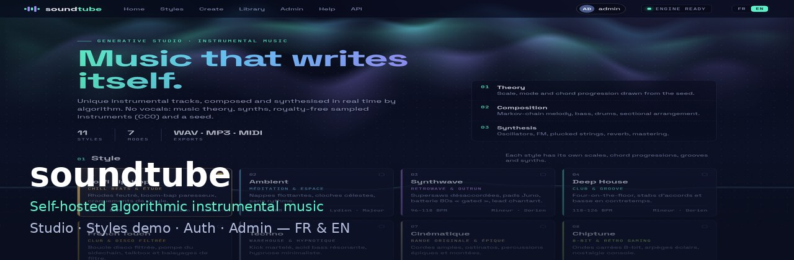
</p>

<p align="center">
  <strong>soundtube</strong> — plateforme <em>auto-hébergée</em> de musique instrumentale algorithmique (sans voix).<br/>
  Théorie musicale · synthèse temps réel · démo Styles · studio, bibliothèque &amp; admin — <strong>FR &amp; EN</strong>
</p>

<p align="center">
  <a href="https://github.com/fredcolinlux/soundtube/releases/tag/v1.20.4"></a>
  
  
  
</p>

<p align="center">
  <a href="README.md">English</a> ·
  <a href="QUICKSTART.fr.md">Démarrage rapide</a> ·
  <a href="docs/MANUEL-UTILISATEUR.md">Manuel</a> ·
  <a href="docs/MANUEL-INSTALLATION.md">Installation</a> ·
  <a href="docs/SECURITY.md">Sécurité</a> ·
  <a href="CHANGELOG.md">Journal</a>
</p>

<p align="center">
  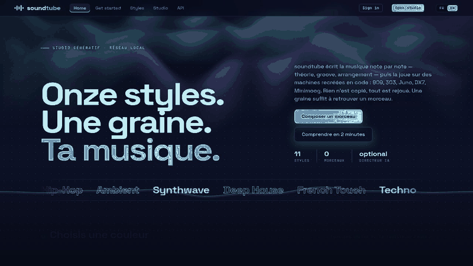
</p>

---


> **Routes :** `/` accueil public · `/studio` générateur (connexion) · `/styles` catalogue · `/accueil` → `/`.

## Pourquoi soundtube ?

La plupart des outils « IA musique » sont des SaaS fermés. **soundtube** tourne sur *ton* matériel :

- **Moteur procédural** — gammes, progressions, mélodies de Markov, batterie, formes intro→outro, puis synthèse temps réel.
- **Interface soignée** — accueil, Styles, studio, bibliothèque, YouTube optionnel, Admin — bascule **FR | EN**.
- **Auth prête pour Internet** — sessions, CSRF, TOTP optionnel (QR) & passkeys, Admin **LAN only**.
- **Démo Styles anonyme** — **aperçu audio 15 s** (écoute seule : pas de téléchargement, publication ni bibliothèque).
- **Auto-hébergé** — LXC Debian / bare metal, compatible NPM, en-têtes type WebGuardian.

## Points forts

| Zone | Contenu |
|------|---------|
| **Studio** | Génération complète, réglages avancés, MIDI, pack ZIP, nœuds vidéo |
| **Styles** | Fiches riches + **démo 15 s** hors connexion |
| **Bibliothèque** | Écoute, régénération, export (connecté) |
| **Auth** | Setup, login, inscriptions optionnelles, 2FA profil |
| **Admin** | Sécurité (proxy/domaine), users, nœuds, directeur IA — **LAN + admin** |
| **i18n** | 800+ clés, Mentions / Confidentialité / CGU |

## Galerie

| Accueil | Démo Styles | Studio |
|:---:|:---:|:---:|
| 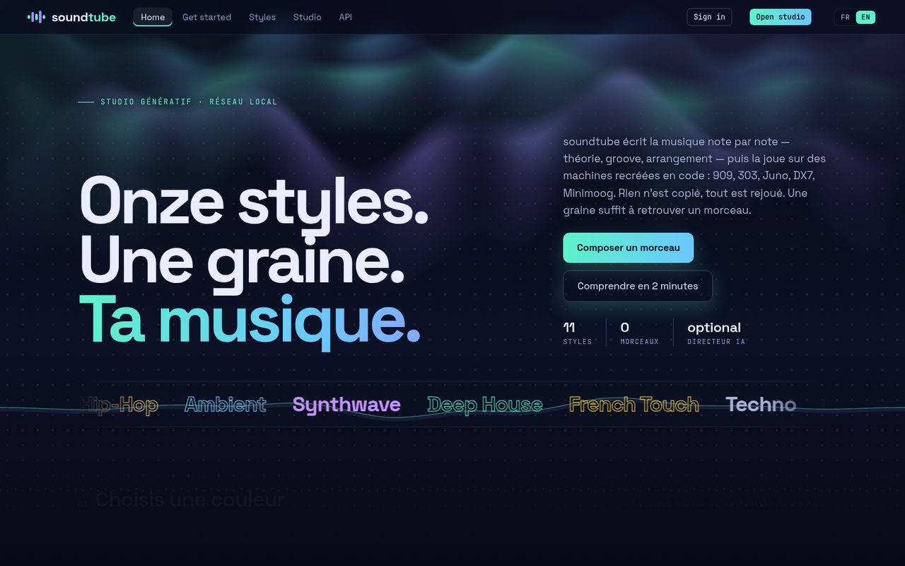 | 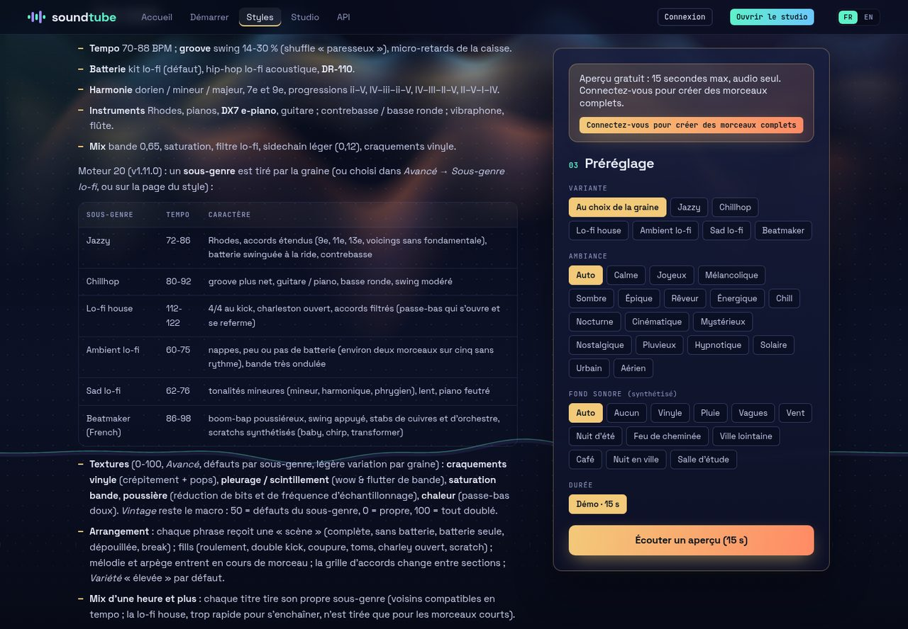 | 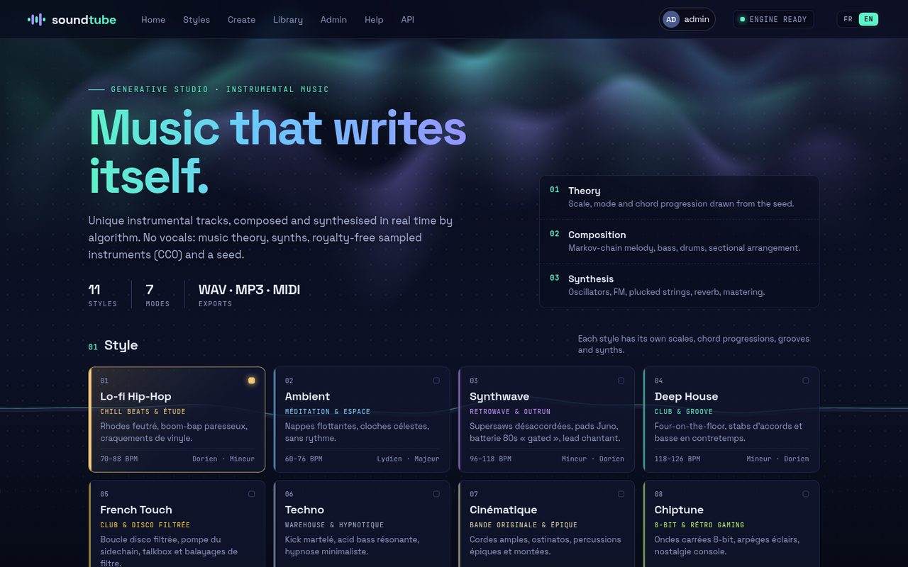 |

| Bibliothèque | Admin | Connexion |
|:---:|:---:|:---:|
| 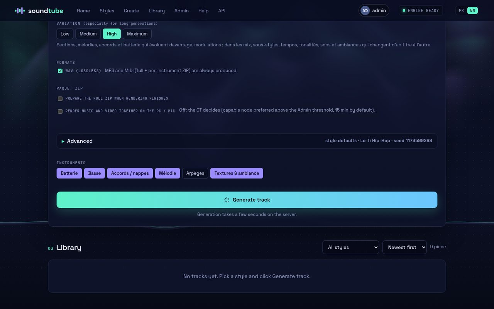 | 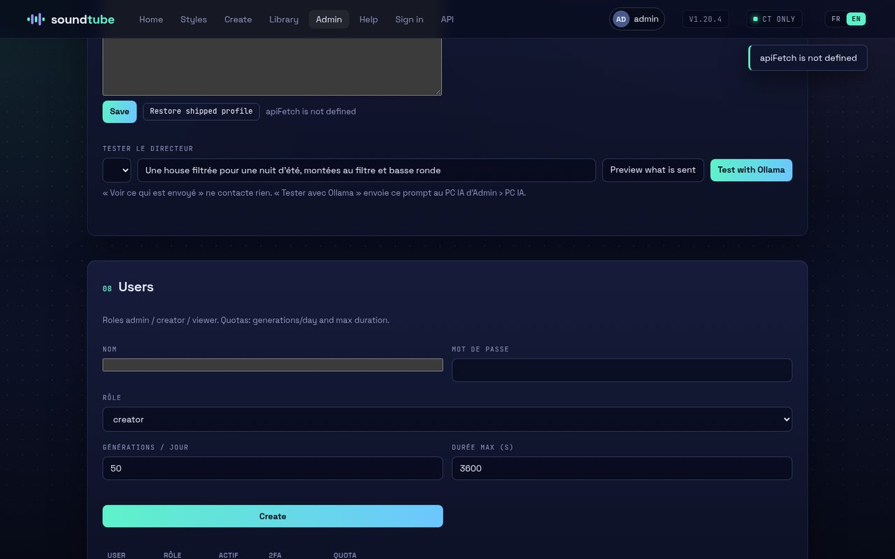 | 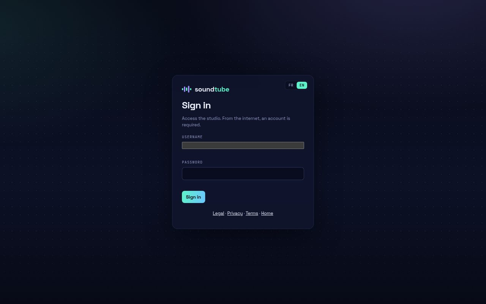 |

| 404 | Enrollement TOTP | Mobile |
|:---:|:---:|:---:|
| 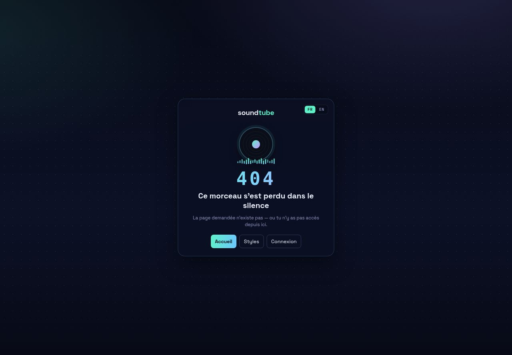 | 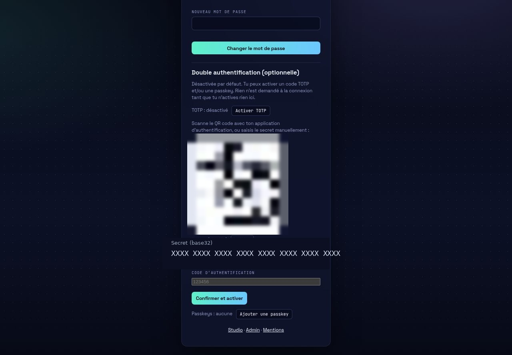 | 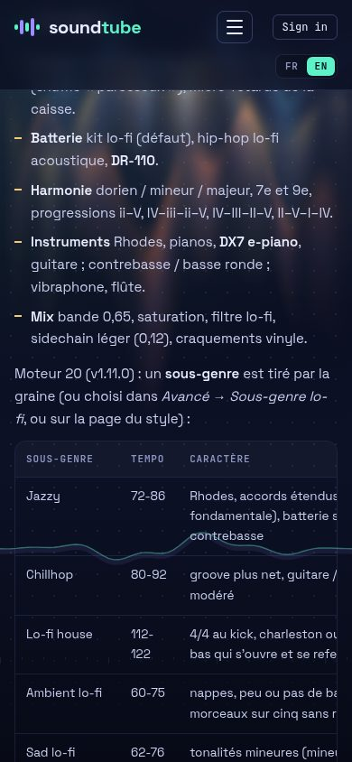 |

## Démarrage en 3 étapes

```bash
# 1) Décompresser le standalone
tar -xzf soundtube-1.20.4-standalone.tar.gz
cd soundtube

# 2) Installer (Debian 13 LXC / bare metal — en root)
./deploy/install.sh --port 8080

# 3) Ouvrir le wizard LAN
#    http://<hôte>:8080/setup   → identifiant + mot de passe (pas d’OTP imposé)
```

Derrière **NPM** : Proxy Host → CT, snippet `deploy/npm-admin-block.conf`, puis confirmer proxy + domaine dans **Admin → Sécurité**.

**Patch** (archive à plat) :

```bash
tar xzf soundtube-1.20.4-patch.tar.gz -C /opt/soundtube/app --no-same-owner
```

## Architecture

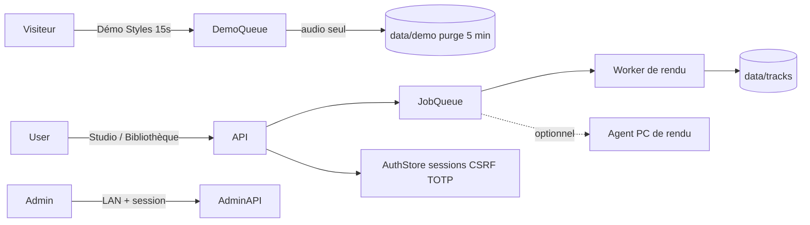

## Manuels

Voir le tableau dans [README.md](README.md#manuals) — chemins `docs/` et `docs/en/`.

## Sécurité (résumé)

- Studio + APIs de génération : **login pour tous**.
- Admin = LAN **et** session admin ; hors LAN → **404** brandée.
- TOTP optionnel avec QR SVG serveur ; codes de récupération une fois.
- Démo Styles : 15 s, rate-limit, **écoute seule** (`401` sur download/publish/library).

## FAQ

**GPU obligatoire ?** Non pour les rendus courts sur le CT. Nœuds Windows/macOS optionnels pour le long / la vidéo.

**La démo Styles est-elle gratuite ?** Oui : **15 s, audio, écoute seule**. Connexion pour les morceaux complets.

**Admin depuis Internet ?** Non — 404 brandée. Passe par le LAN / VPN.

**OTP au setup ?** Non. La 2FA est optionnelle dans **Mon profil**.

**Licence ?** Tous droits réservés — [`LICENSE`](LICENSE).

## Releases

➡️ **[GitHub Releases](https://github.com/fredcolinlux/soundtube/releases)** — archives standalone + patch.
