<p align="center">
  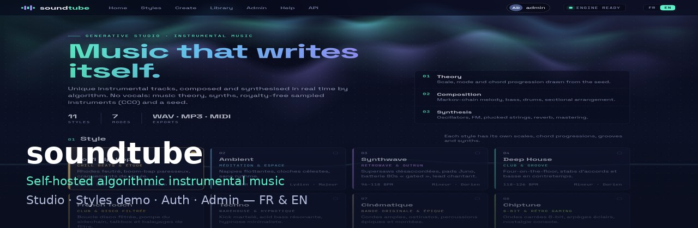
</p>

<p align="center">
  <strong>soundtube</strong> — self-hosted platform for <em>algorithmic instrumental music</em> (no vocals).<br/>
  Compose with theory · synthesise in real time · optional Styles demo · studio, library &amp; admin — <strong>FR &amp; EN</strong>
</p>

<p align="center">
  <a href="https://github.com/fredcolinlux/soundtube/releases/tag/v1.21.4"></a>
  
  
  
</p>

<p align="center">
  <a href="README.fr.md">Français</a> ·
  <a href="QUICKSTART.md">Quick start</a> ·
  <a href="docs/en/USER-MANUAL.md">User manual</a> ·
  <a href="docs/en/INSTALL-MANUAL.md">Install</a> ·
  <a href="docs/SECURITY.md">Security</a> ·
  <a href="CHANGELOG.md">Changelog</a>
</p>

<p align="center">
  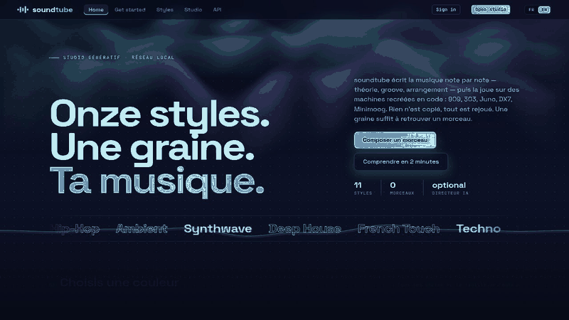
</p>

---


> **Routes:** `/` public home · `/studio` generator (login) · `/styles` catalogue · `/accueil` → `/`.

## Why soundtube?

Most “AI music” tools are SaaS black boxes. **soundtube** runs on *your* hardware:

- **Procedural engine** — scales, progressions, Markov melodies, drums, intro→outro forms, then real-time synthesis (no sample packs of commercial machines required).
- **Beautiful UI** — home, Styles, studio, library, optional YouTube publish, Admin — with a **FR | EN** switch.
- **Internet-ready auth** — sessions, CSRF, optional TOTP (QR enrolment) & passkeys, LAN-only Admin.
- **Anonymous Styles demo** — visitors get a **15 s audio preview** (listen only; no download, publish, or library). Sign in for full tracks.
- **Self-hosted** — Debian LXC / bare metal, Nginx Proxy Manager friendly, WebGuardian-minded headers.

## Feature highlights

| Area | What you get |
|------|----------------|
| **Studio** | Full generation: duration presets, advanced tweaks, stems/MIDI, pack ZIP, video nodes |
| **Styles** | Rich style pages + **15 s demo** when signed out |
| **Library** | Browse, play, regenerate, export (signed-in) |
| **Auth** | Setup wizard, login, optional open registration, profile 2FA |
| **Admin** | Security (proxy/domain confirm), users, nodes, AI director, trends — **LAN + admin only** |
| **i18n** | 800+ UI keys, Mentions / Privacy / Terms FR+EN |

## Gallery

| Home | Styles demo (anon) | Studio |
|:---:|:---:|:---:|
| 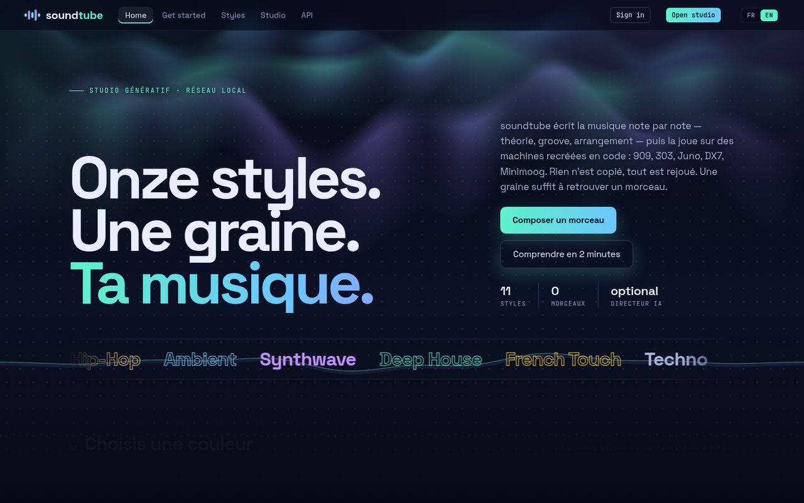 | 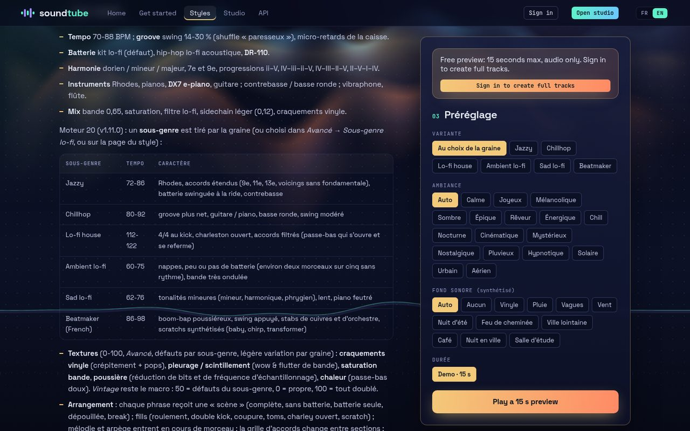 | 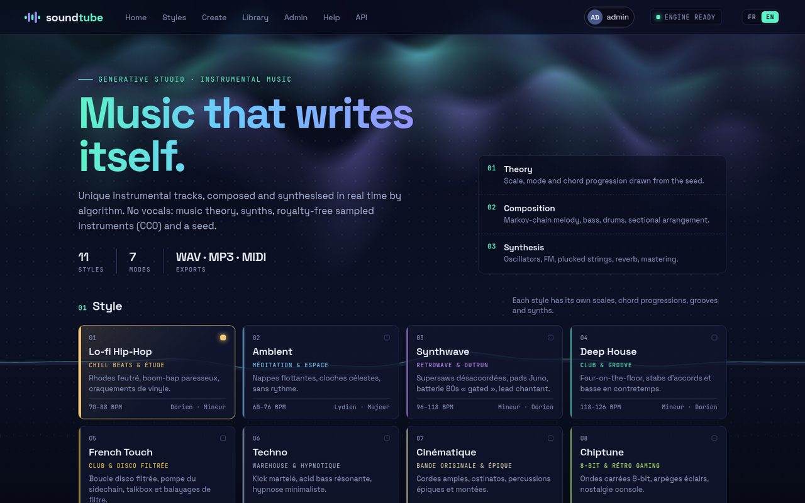 |

| Library | Admin | Login |
|:---:|:---:|:---:|
| 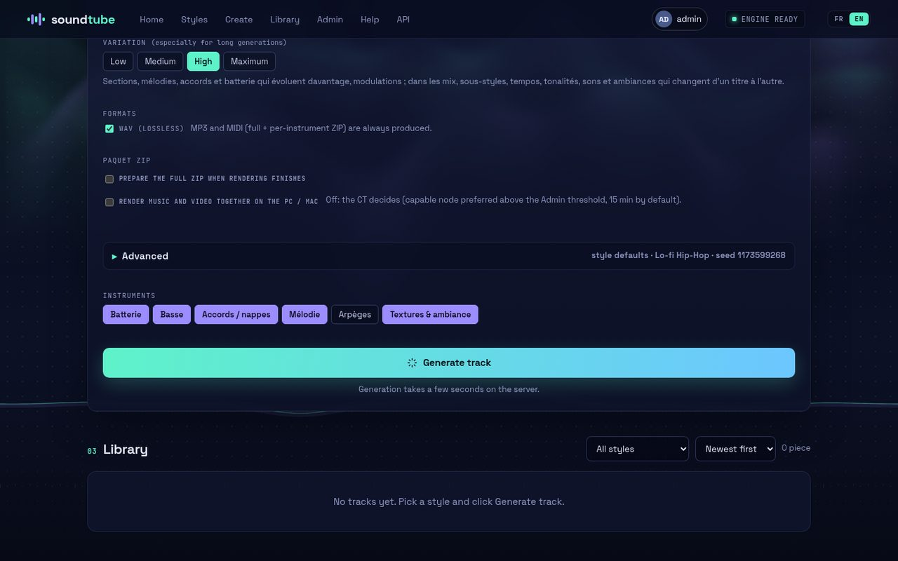 | 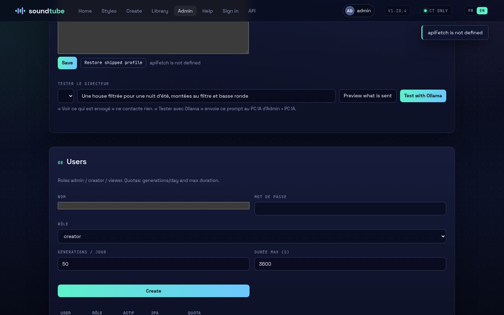 | 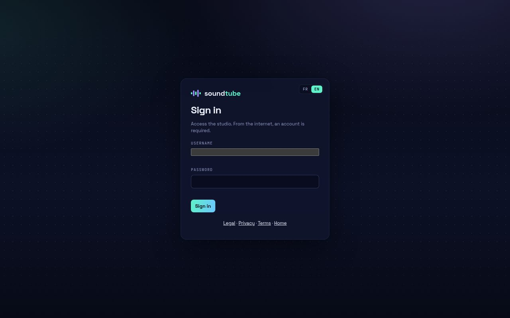 |

| 404 | TOTP enrolment | Mobile demo |
|:---:|:---:|:---:|
| 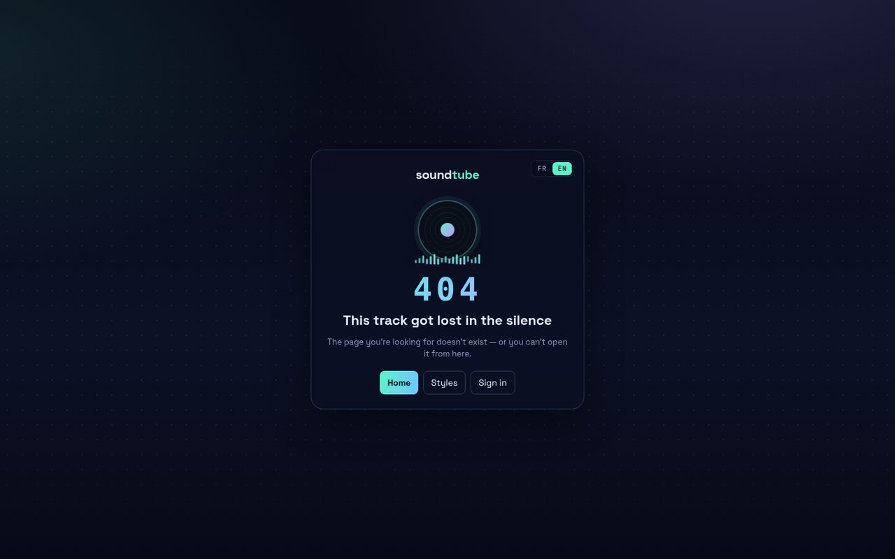 | 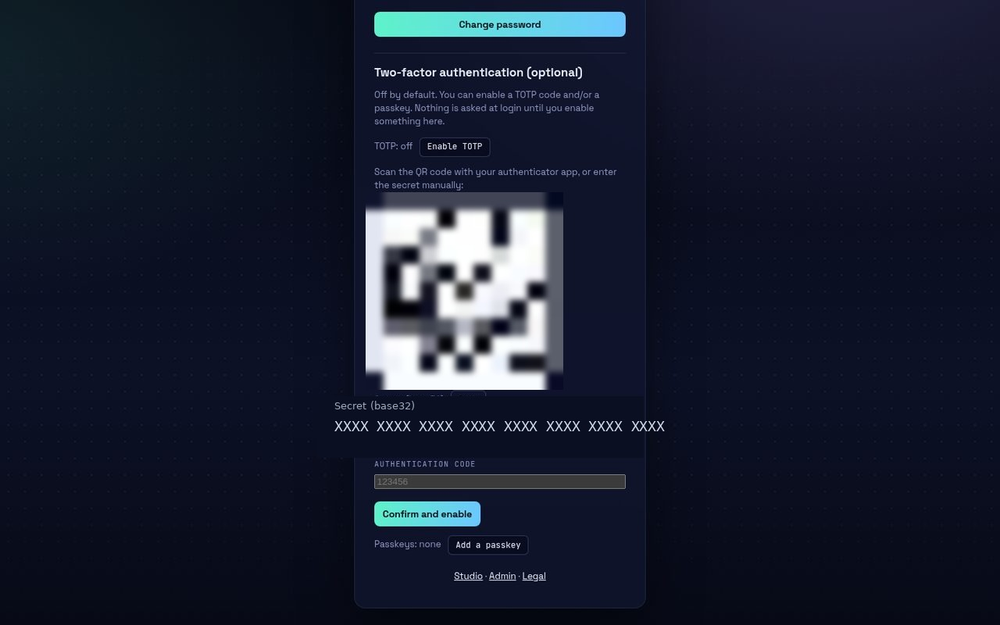 | 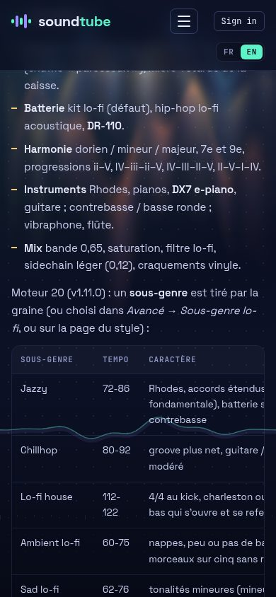 |

## Quick start (3 steps)

```bash
# 1) Extract the standalone release
tar -xzf soundtube-1.20.4-standalone.tar.gz
cd soundtube

# 2) Install (Debian 13 LXC / bare metal — as root)
./deploy/install.sh --port 8080

# 3) Open the LAN setup wizard
#    http://<host>:8080/setup   → username + password only (no OTP nag)
```

Behind **Nginx Proxy Manager**: point the Proxy Host at the CT, paste `deploy/npm-admin-block.conf`, then confirm proxy + domain in **Admin → Security**.

**Upgrade patch** (flat archive):

```bash
tar xzf soundtube-1.20.4-patch.tar.gz -C /opt/soundtube/app --no-same-owner
# restart the soundtube service
```

Update with `/opt/soundtube/app/scripts/update.sh <patch.tar.gz>` (verifies archives before stop).

More detail: [QUICKSTART.md](QUICKSTART.md) · [docs/en/INSTALL-MANUAL.md](docs/en/INSTALL-MANUAL.md)

## Architecture

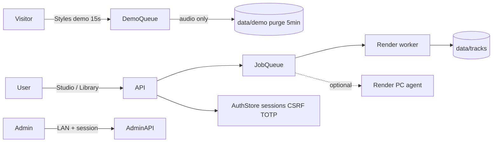

## Manuals

| | Français | English |
|--|----------|---------|
| User | [MANUEL-UTILISATEUR](docs/MANUEL-UTILISATEUR.md) | [USER-MANUAL](docs/en/USER-MANUAL.md) |
| Install | [MANUEL-INSTALLATION](docs/MANUEL-INSTALLATION.md) | [INSTALL-MANUAL](docs/en/INSTALL-MANUAL.md) |
| Operations | [EXPLOITATION](docs/EXPLOITATION.md) | [OPERATIONS](docs/en/OPERATIONS.md) |
| Security / exposure | [SECURITY](docs/SECURITY.md) · [EXPOSITION](docs/EXPOSITION.md) | [en/SECURITY](docs/en/SECURITY.md) · [en/EXPOSITION](docs/en/EXPOSITION.md) |

## Security (short)

- Studio + generation APIs require **login for everyone** (no LAN bypass).
- **Admin** = LAN **and** admin session; off-LAN → branded **404**.
- Optional **TOTP** with server-side SVG QR (`/api/me/totp/qr.svg`), recovery codes once.
- Styles **demo**: 15 s cap, rate-limit, preview-only (`401` on download/publish/library for demo ids).
- CSP / COOP / COEP / HSTS-ready headers; secrets sealed at rest.
- Locked out (lost OTP / password)? On the server: `node /opt/soundtube/app/scripts/admin-reset.js <user> --disable-2fa --password` (root, console/LAN only, works with the service running) — see [docs/en/SECURITY.md](docs/en/SECURITY.md).

## FAQ

**Do I need GPU?**  
No for short CT renders. Optional Windows/macOS **render nodes** help for long tracks / video.

**Is the Styles demo free for visitors?**  
Yes: **15 seconds, audio only, listen-only**. No YouTube, ZIP, or library save. Sign in for full tracks.

**Can Admin be opened from the internet?**  
No by design — returns the branded 404. Use LAN / VPN / Tailscale.

**OTP at first setup?**  
No. Setup is username + password. 2FA is optional later under **My profile**.

**Licence?**  
All rights reserved — see [`LICENSE`](LICENSE).

## Releases

Download **standalone** and **patch** archives from  
➡️ **[GitHub Releases](https://github.com/fredcolinlux/soundtube/releases)**

```
soundtube @ v1.21.4
```
